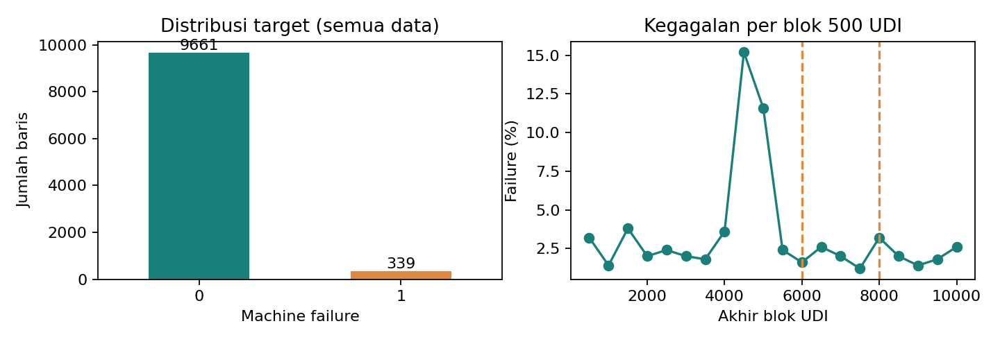
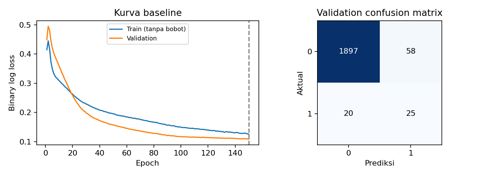

TE2514031 | GASAL 2026/2027 | PROGRES MINGGU 12

# Intelligent Predictive Maintenance System

**Kelompok 01 · Kelas: BELUM DIISI** Dataset AI4I 2020 (UCI ID 601) · Target: Machine failure (0/1)

## 1. Masalah, tujuan, dan batas sistem

Kondisi operasi mesin dapat digunakan untuk mengidentifikasi indikasi kegagalan dan membantu penentuan prioritas perawatan. Proyek ini membangun sistem hibrida yang memetakan jenis produk dan sensor operasi ke prediksi kegagalan, kemudian ke keputusan perawatan yang dapat dijelaskan.

**Tujuan terukur:** menghasilkan baseline NN yang dapat diulang; pada tahap berikutnya membandingkan GA+NN, PSO+NN dan GA+PSO+NN memakai split tetap. Kualitas deteksi failure dinilai melalui precision, recall dan F1, disertai metrik lain. Fuzzy menjadi lapisan keputusan, bukan jaminan peningkatan akurasi.

**Batasan:** klasifikasi kondisi pada satu pengamatan, bukan prediksi waktu menuju kegagalan atau remaining useful life. Dataset sintetis; skor baseline belum dikalibrasi untuk penerapan industri.

## 2. Rancangan arsitektur

| Tahap | Alur dan status |
|---|---|
| W12 · tersedia | UCI → validasi data → split → imputer/scaler/encoding → baseline MLP → prediksi Streamlit |
| W13–W15 · rencana | Preprocessing → GA seleksi fitur → PSO hyperparameter → NN → Fuzzy → dashboard online |

Input akhir dashboard: kondisi mesin manual/CSV. Keluaran akhir yang direncanakan: probabilitas failure, subset sensor hasil GA, serta prioritas Normal / Inspection / Maintenance / Critical. Saat W12, keluaran yang berfungsi baru prediksi baseline.

## 3. Anggota dan usulan pembagian peran

| NIM · Nama | Usulan tanggung jawab |
|---|---|
| 04231072 · Putri Cahaya Lestari | Data, EDA, preprocessing dan dokumentasi |
| 04231038 · Hendra Firmansyah | GA, fitness dan analisis subset fitur |
| 04231070 · Nur Rahmad | Baseline NN, PSO dan evaluasi eksperimen |
| 04221045 · Ricky Alfian Ronaldo | Fuzzy, integrasi Streamlit dan deployment |

Pembagian peran di atas merupakan usulan, perlu disepakati anggota; bukan bukti kontribusi yang telah dilakukan. Setiap anggota tetap perlu memahami seluruh pipeline saat demo.

---

## 4. Data dictionary dan kebijakan input

Sumber: AI4I 2020 Predictive Maintenance Dataset, UCI 601. File resmi memuat 10.000 observasi dan 14 kolom; hanya enam variabel dipakai sebagai input. Type di-one-hot menjadi tiga kolom, sehingga NN menerima delapan input.

| Variabel | Tipe / satuan | Peran |
|---|---|---|
| Type | Kategori H/L/M | Input kualitas produk |
| Air temperature [K] | Numerik / K | Input suhu udara |
| Process temperature [K] | Numerik / K | Input suhu proses |
| Rotational speed [rpm] | Numerik / rpm | Input kecepatan rotasi |
| Torque [Nm] | Numerik / Nm | Input torsi |
| Tool wear [min] | Numerik / menit | Input keausan alat |
| Machine failure | Biner 0/1 | Target utama |
| UDI; Product ID | Identitas | Dikeluarkan; UDI hanya untuk split |
| TWF/HDF/PWF/OSF/RNF | Label jenis failure | Dikeluarkan untuk mencegah leakage |

## 5. Temuan EDA dan kualitas data

Ditemukan **0 sel kosong**, 0 duplikasi baris penuh dan 0 duplikasi kombinasi enam fitur. Distribusi target: 9.661 non-failure (96,61%) dan 339 failure (3,39%). Imbalance perlu ditangani pada training; accuracy saja tidak cukup.

Grafik memperlihatkan proporsi kegagalan berbeda antarblok UDI. Karena suhu dibangkitkan dengan pola random walk dan urutan berpotensi berkorelasi, split tidak diacak. UDI bukan timestamp yang terverifikasi; evaluasi tetap tidak membuktikan generalisasi pada mesin atau periode nyata yang independen.

Analisis lengkap tersedia pada W12/eda/: statistik numerik, missing values, korelasi, distribusi fitur, failure menurut Type, dan ringkasan JSON. Korelasi dipakai sebagai deskripsi, bukan dasar menyaring fitur dengan melihat test. Dataset bersifat sintetis sebagaimana keterangan UCI.

---

## 6. Split aman dan preprocessing

| Split | Rentang UDI | Baris | Failure |
|---|---|---|---|
| Train | 1–6000 | 6.000 | 255 (4,25%) |
| Validation | 6001–8000 | 2.000 | 45 (2,25%) |
| Test terkunci | 8001–10000 | 2.000 | 39 (1,95%) |

Imputer median/mode dan StandardScaler fit hanya pada train. Type memakai kategori kamus H/L/M. Walaupun tidak ada missing values, imputer disimpan bersama model agar pipeline konsisten. Bobot kelas dihitung dari train: w(c)=n_train/(2 n_c), yaitu 0,5222 untuk kelas 0 dan 11,7647 untuk kelas 1; validation/test tidak di-resample.

Manifest split menyimpan UDI untuk audit. Validation dipakai memilih checkpoint; threshold tetap 0,5. Test belum dihitung metriknya dan tidak digunakan untuk preprocessing, fitness, tuning atau checkpoint. EDA semua data merupakan audit deskriptif; pemilihan model tidak menggunakan statistik test.

## 7. Baseline Neural Network dan hasil validasi

MLP: 8 input → 32 ReLU → 16 ReLU → 1 sigmoid; **833 parameter**. Adam, learning rate 0,001; batch 128; L2 0,0001; tanpa dropout; seed 42. Maksimum 150 epoch, patience 20 berdasarkan log loss validation; checkpoint terbaik epoch 150. Satu run awal; bukan hasil GA/PSO.

| Model (validation) | Accuracy | Precision | Recall | F1 |
|---|---|---|---|---|
| Dummy selalu non-failure | 0,9775 | 0 | 0 | 0 |
| MLP baseline | 0.9610 | 0.3012 | 0.5556 | 0.3906 |

AP=0.4710; ROC AUC=0.9234; balanced accuracy=0.7629. Confusion matrix: TN=1.897, FP=58, FN=20, TP=25. Model menemukan 25 dari 45 failure, tetapi masih melewatkan 20 failure dan menghasilkan 58 false alarm. Hasil ini menunjukkan ruang perbaikan; belum ada klaim keunggulan optimasi.

Kurva loss train/validation di atas dihitung tanpa bobot agar dapat dibandingkan; pembaruan bobot NN tetap memakai class weights. Artefak baseline.joblib menyimpan preprocessing dan model untuk inference; hasil setelah reload diverifikasi sama.

---

## 8. Rencana integrasi W13–W16

| Minggu | Rencana teknis dan keluaran |
|---|---|
| 13 · GA | Kromosom 6 bit; Type satu grup. Tolak subset kosong. Fitness F1 validation dengan penalti jumlah fitur. Usulan populasi 20/generasi 15, crossover 0,8, mutation 1/6, elitism 2; seed 11/22/33. Tetapkan bobot penalti sebelum run; simpan convergence dan best/mean/std. |
| 14 · PSO + NN | Optimasi lr (10^-4–10^-2), hidden units (16–128), dropout (0–0,5), batch (32/64/128). Implementasi pbest/gbest dan update posisi-kecepatan. Bandingkan empat konfigurasi, split/budget setara dan beberapa seed. |
| 15 · FIS + deploy | Rancang Mamdani + centroid. Input usulan probabilitas failure, wear dan torque; output empat prioritas. Validasi membership/rules dan skenario ekstrem. Integrasi end-to-end dan URL Streamlit publik. |
| 16 · UAS | Laporan final, slide, demo langsung, video, source, artefak dan bukti kontribusi nyata. Siapkan demo lokal sebagai cadangan. |

**Catatan dropout:** MLPClassifier W12 tidak mendukung dropout. Pada W14 seluruh empat konfigurasi, termasuk baseline, akan dilatih ulang dengan backend NN yang mendukung dropout agar pembandingan konsisten. Search bounds di atas masih rancangan, bukan hasil pencarian.

## 9. Risiko dan mitigasi

**Leakage:** buang label jenis failure/ID, fit preprocessing hanya train, kunci test. **Imbalance:** class weights dari train dan evaluasi kelas positif. **Overfitting validation:** catat budget pencarian, beberapa seed dan evaluasi akhir sekali setelah model terkunci. **Data sintetis dan urutan:** jelaskan keterbatasan generalisasi. **False alarm/FN:** laporkan keduanya; threshold 0,5 belum dioptimalkan. **Deployment:** pin dependensi, simpan artefak dan uji URL publik tanpa login.

## 10. Status pengumpulan dan reproduksi

**Tersedia:** laporan 4 halaman; script EDA/preprocessing/baseline; statistik, grafik, manifest split, metrik validation, model tersimpan, README, requirements dan delapan area Streamlit. Prediksi manual/CSV memakai NN asli. GA/PSO/Fuzzy diberi status rencana.

**Kelas:** BELUM DIISI. **Repository remote:** BELUM DIISI. **Dashboard publik:** BELUM DEPLOY. Git lokal tersedia pada workspace; URL repository dan deployment perlu dilengkapi. W12 mengizinkan bukti aplikasi awal lokal; URL skeleton dicantumkan bila tersedia.

Reproduksi (Python 3.12): pip install -r requirements.txt; python -m src.eda; python -m src.train_baseline --seed 42; streamlit run app.py. Unggah PDF progres dan URL repo ke Moodle; tenggat resmi mengikuti Moodle/pengampu.

## Sumber

1. Panduan Deliverables Tubes KB Minggu 12–16 (PDF dosen), hlm. 1–3. 2. Tugas Besar KB 16 Kelompok UCI Streamlit (PDF dosen), hlm. 5 dan 9. 3. UCI AI4I 2020, DOI: 10.24432/C5HS5C (CC BY 4.0). https://archive.ics.uci.edu/dataset/601/ai4i+2020+predictive+maintenance+dataset 4. Deployment resmi: https://docs.streamlit.io/deploy/streamlit-community-cloud/deploy-your-app