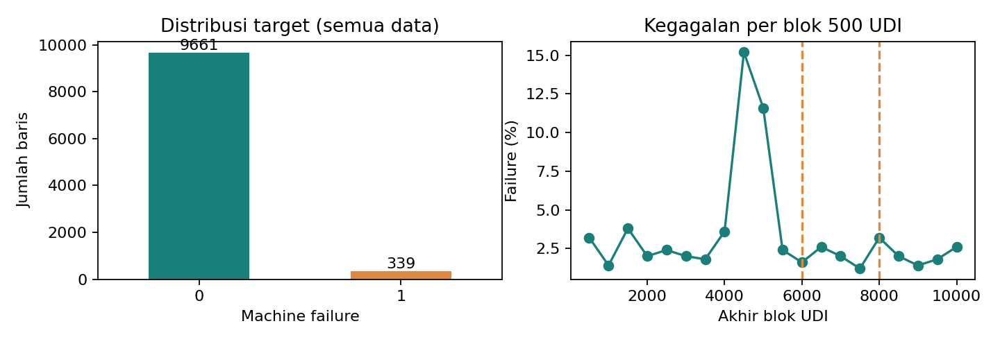
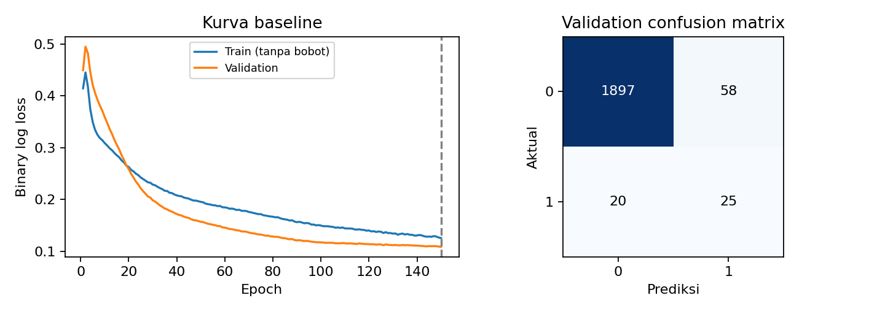

PROPOSAL DAN LAPORAN PROGRES
TUGAS BESAR KECERDASAN BUATAN

INTELLIGENT PREDICTIVE MAINTENANCE SYSTEM
BERBASIS GA, PSO, NEURAL NETWORK, DAN FUZZY LOGIC

Progres Minggu ke-12
Semester Gasal Tahun Akademik 2026/2027

Disusun untuk memenuhi tugas mata kuliah
Kecerdasan Buatan (TE2514031)

Dosen Pengampu:
Ir. Muhammad Ridho Dewanto, S.T., M.T.

Disusun oleh:
Kelompok 1 — Kelas B

Putri Cahaya Lestari — 04231072

Hendra Firmansyah — 04231038

Nur Rahmad — 04231070

Ricky Alfian Ronaldo — 04221045

INSTITUT TEKNOLOGI KALIMANTAN
2026

KATA PENGANTAR

Proposal dan laporan progres ini disusun untuk memenuhi tahapan minggu ke-12 Tugas Besar mata kuliah Kecerdasan Buatan, Institut Teknologi Kalimantan, semester gasal tahun akademik 2026/2027. Topik yang dikembangkan oleh Kelompok 1 Kelas B adalah Intelligent Predictive Maintenance System dengan memanfaatkan AI4I 2020 Predictive Maintenance Dataset dari UCI Machine Learning Repository.

Dokumen ini memuat latar belakang, landasan teori, rancangan sistem, metodologi pengolahan data, serta hasil awal eksplorasi dan pelatihan baseline Neural Network. Pada tahap berikutnya, sistem direncanakan mengintegrasikan Genetic Algorithm, Particle Swarm Optimization, Fuzzy Logic, dan dashboard Streamlit yang dapat diakses melalui internet.

Penyusun mengucapkan terima kasih kepada dosen pengampu, Ir. Muhammad Ridho Dewanto, S.T., M.T., atas arahan pembelajaran dan ketentuan pelaksanaan tugas besar. Dokumen ini masih terbatas pada progres awal. Saran dan masukan diperlukan untuk memperbaiki rancangan, eksperimen, dan penyajian hasil pada tahap selanjutnya.

November 2026

Kelompok 1

DAFTAR ISI

# BAB I
PENDAHULUAN

## 1.1 Latar Belakang

Kegagalan mesin dapat mengganggu keberlangsungan proses operasi. Informasi kondisi mesin, seperti suhu, kecepatan putaran, torsi, dan keausan alat, dapat digunakan sebagai masukan untuk mengidentifikasi indikasi kegagalan. Pengolahan data tersebut menjadi prediksi dan rekomendasi perawatan merupakan dasar pengembangan sistem predictive maintenance dalam tugas besar ini.

AI4I 2020 menyediakan data sintetis yang menggambarkan karakteristik predictive maintenance untuk keperluan pengembangan metode (UCI Machine Learning Repository, 2020). Data ini memungkinkan eksperimen klasifikasi kegagalan secara terukur, tetapi tidak dapat langsung mewakili seluruh kondisi mesin industri nyata.

Sistem yang diusulkan memadukan GA untuk seleksi fitur, PSO untuk optimasi hyperparameter, Neural Network sebagai model prediksi, serta Fuzzy Logic untuk menentukan prioritas perawatan. Minggu ke-12 difokuskan pada pemahaman data, pencegahan kebocoran informasi, pelatihan baseline, dan pembuatan kerangka Streamlit sesuai panduan tugas besar.

## 1.2 Rumusan Masalah

1. Bagaimana menyiapkan data AI4I 2020 dan membaginya untuk pengembangan model tanpa membocorkan informasi target?

2. Bagaimana kinerja awal MLP dalam mendeteksi kegagalan mesin pada data dengan kelas yang tidak seimbang?

3. Bagaimana merancang integrasi GA, PSO, NN, Fuzzy Logic, dan Streamlit untuk tahap pengembangan berikutnya?

## 1.3 Tujuan

1. Menghasilkan eksplorasi data, kamus variabel, dan pipeline preprocessing yang dapat dijalankan ulang.

2. Membangun baseline MLP dan mengukur kinerja deteksi kelas kegagalan pada data validasi.

3. Menyusun arsitektur sistem hibrida, kerangka dashboard, pembagian peran, dan rencana pengerjaan minggu ke-13 sampai ke-16.

## 1.4 Batasan Masalah

Pengamatan dibatasi pada dataset AI4I 2020, target biner Machine failure, dan enam variabel masukan. Sistem belum mengestimasi sisa umur mesin atau waktu menuju kerusakan. Hasil minggu ke-12 adalah baseline tanpa GA, PSO, dan Fuzzy. Implementasi publik Streamlit serta pengujian sistem hibrida dilakukan pada tahapan berikutnya. Prediksi belum ditujukan sebagai dasar keputusan operasional industri.

## 1.5 Manfaat

Proyek diharapkan menjadi sarana penerapan optimasi, pembelajaran, dan pengambilan keputusan dalam satu pipeline yang dapat dijelaskan. Dashboard juga diharapkan memudahkan pengguna mengeksplorasi data dan memahami hubungan antara masukan mesin, prediksi model, dan prioritas perawatan.

# BAB II
TINJAUAN PUSTAKA

## 2.1 Predictive Maintenance dan Dataset AI4I 2020

Dalam proyek ini, predictive maintenance dioperasionalkan sebagai klasifikasi status kegagalan berdasarkan kondisi operasi pada satu pengamatan. Dataset AI4I 2020 merupakan data sintetis dari UCI yang mencakup jenis produk, lima variabel operasi, dan label kegagalan. Penggunaan data sintetis membantu penyusunan eksperimen awal, tetapi validasi pada data nyata masih diperlukan sebelum penerapan di lapangan (UCI Machine Learning Repository, 2020).

## 2.2 Neural Network dan Multilayer Perceptron

Neural Network mempelajari hubungan antara input dan keluaran melalui penyesuaian bobot. Backpropagation menghitung perubahan bobot berdasarkan galat keluaran (Rumelhart, Hinton, dan Williams, 1986). MLP dipilih karena masukan proyek berbentuk tabel per pengamatan. Implementasi baseline menggunakan MLPClassifier dengan lapisan tersembunyi beraktivasi ReLU dan output biner (scikit-learn developers, t.t.-a).

## 2.3 Genetic Algorithm

GA menggunakan populasi kandidat solusi serta operasi seleksi, crossover, dan mutasi untuk melakukan pencarian. Konsep adaptasi dan pencarian melalui mekanisme evolusi dijelaskan oleh Holland (1992). Pada proyek ini, GA direncanakan memilih subset variabel masukan. Setiap kromosom berupa enam bit, sedangkan semua kolom hasil encoding Type diperlakukan sebagai satu kelompok fitur.

## 2.4 Particle Swarm Optimization

PSO menggerakkan sekumpulan partikel dalam ruang pencarian dengan mempertimbangkan solusi terbaik masing-masing partikel dan solusi terbaik kelompok (Kennedy dan Eberhart, 1995). Perannya dalam proyek ini adalah mencari konfigurasi hyperparameter NN, meliputi learning rate, jumlah hidden units, dropout, dan batch size. Hasil terbaik tetap perlu dibuktikan melalui evaluasi dengan protokol yang konsisten.

## 2.5 Fuzzy Logic

Himpunan fuzzy menyatakan derajat keanggotaan suatu nilai, sehingga konsep linguistik dapat direpresentasikan secara bertahap (Zadeh, 1965). Fuzzy Logic direncanakan mengolah probabilitas kegagalan dan kondisi mesin menjadi empat prioritas perawatan, yaitu Normal, Inspection, Maintenance, dan Critical. Perancangan mencakup fungsi keanggotaan, aturan, inferensi, dan defuzzification.

## 2.6 Evaluasi dan Pencegahan Data Leakage

Pada klasifikasi yang tidak seimbang, accuracy perlu dibaca bersama precision, recall, F1-score, dan confusion matrix. Data leakage terjadi ketika informasi yang seharusnya belum tersedia ikut memengaruhi pelatihan atau pemilihan model. Pemisahan data dan penyimpanan preprocessing bersama model membantu menjaga konsistensi proses training dan inference (scikit-learn developers, t.t.-b).

## 2.7 Dashboard Streamlit

Streamlit digunakan sebagai antarmuka untuk menampilkan eksplorasi data, evaluasi model, dan prediksi interaktif. Dokumen tugas menetapkan bahwa aplikasi akhir harus dapat diakses melalui internet tanpa izin khusus. Deployment direncanakan menggunakan Streamlit Community Cloud dengan source, dependensi, dan artefak model yang tersimpan dalam repository (Streamlit, t.t.).

# BAB III
METODOLOGI DAN RANCANGAN SISTEM

## 3.1 Jenis dan Tahapan Pengerjaan

Pengerjaan menggunakan eksperimen komputasional pada data sekunder. Tahapannya meliputi pengumpulan data, pemeriksaan kualitas, pembagian data, preprocessing, pembangunan baseline, optimasi, penyusunan FIS, integrasi dashboard, dan evaluasi. Tahap optimasi dan FIS masih merupakan rancangan pada laporan progres ini.

Tabel 3.1 Rancangan alur sistem

| Tahap | Proses dan keluaran |
|---|---|
| Data dan preprocessing | Dataset UCI → audit → split → encoding dan standardisasi. |
| Baseline W12 | Enam variabel → MLP → probabilitas kegagalan → evaluasi validation. |
| Optimasi W13–W14 | GA memilih variabel; PSO mencari hyperparameter NN. |
| Integrasi W15 | Prediksi NN → inferensi Fuzzy → prioritas perawatan → Streamlit online. |

## 3.2 Sumber Data dan Definisi Variabel

Dataset bersumber dari UCI ID 601 dengan 10.000 baris dan 14 kolom. Target utama adalah Machine failure dengan nilai 0 untuk non-failure dan 1 untuk failure. Data diunduh dari sumber resmi, dan identitas versi berkas dicatat melalui checksum agar eksperimen dapat diulang.

Tabel 3.2 Kamus variabel dan kebijakan penggunaan

| Variabel | Satuan/tipe | Penggunaan |
|---|---|---|
| Type | Kategori H, L, M | Input; jenis/kualitas produk. |
| Air temperature | Kelvin | Input suhu udara. |
| Process temperature | Kelvin | Input suhu proses. |
| Rotational speed | rpm | Input kecepatan rotasi. |
| Torque | Nm | Input torsi. |
| Tool wear | Menit | Input keausan alat. |
| Machine failure | Biner | Target klasifikasi. |
| UDI; Product ID | Identitas | Tidak menjadi input NN. |
| TWF; HDF; PWF; OSF; RNF | Label failure | Dikeluarkan untuk mencegah leakage. |

Label jenis kegagalan tidak digunakan sebagai prediktor Machine failure karena mengandung informasi keluaran yang hendak diprediksi. UDI dipakai untuk menentukan urutan pembagian data, sedangkan Product ID dikeluarkan sebagai pengenal produk.

## 3.3 Pembagian Data dan Preprocessing

Tabel 3.3 Pembagian data yang digunakan

| Bagian | UDI | Jumlah | Failure |
|---|---|---|---|
| Train | 1–6000 | 6.000 | 255 |
| Validation | 6001–8000 | 2.000 | 45 |
| Test | 8001–10000 | 2.000 | 39 |

Pembagian dilakukan berurutan dengan proporsi 60%/20%/20%. Pendekatan ini mengurangi pencampuran pola antarbaris yang berdekatan. Namun, UDI hanya menjadi proxy urutan; tidak tersedia timestamp terverifikasi. Dengan demikian, pembagian tersebut tidak membuktikan evaluasi peramalan waktu maupun pemisahan mesin yang benar-benar independen.

Imputer numerik menggunakan median dan imputer kategori menggunakan modus, kemudian variabel numerik distandardisasi. Seluruh parameter tersebut dihitung dari train saja. Type diubah menjadi tiga kolom one-hot sehingga terdapat delapan masukan NN. Data validation dan test hanya ditransformasi memakai preprocessing hasil train.

Ketidakseimbangan kelas ditangani dengan bobot kelas w(c) = n_train / (2 × n_c). Bobot kelas 0 sebesar 0,5222 dan kelas 1 sebesar 11,7647. Tidak dilakukan oversampling pada validation atau test. EDA seluruh dataset dipakai untuk audit deskriptif, bukan untuk memilih fitur atau konfigurasi berdasarkan test.

## 3.4 Konfigurasi Baseline Neural Network

Tabel 3.4 Konfigurasi baseline MLP

| Komponen | Konfigurasi |
|---|---|
| Arsitektur | 8 input → 32 ReLU → 16 ReLU → 1 output sigmoid. |
| Jumlah parameter | 833 parameter. |
| Optimasi | Adam; learning rate 0,001; batch size 128. |
| Regularisasi | L2 sebesar 0,0001; tanpa dropout. |
| Training | Maksimum 150 epoch; seed 42; bobot kelas dari train. |
| Checkpoint | Log loss validation terendah; patience 20 epoch. |
| Threshold | 0,5; ditetapkan sebelum evaluasi hasil baseline. |

Model baseline dilatih melalui pembaruan per epoch, lalu checkpoint dipilih dari log loss validation. Model dan preprocessing disimpan dalam satu artefak agar inference menggunakan transformasi yang sama. Test belum dievaluasi dan tetap disimpan untuk penilaian akhir setelah konfigurasi dikunci.

## 3.5 Metrik Evaluasi

Metrik utama adalah recall dan F1 kelas failure, dengan precision untuk melihat konsekuensi false alarm. Accuracy dan confusion matrix tetap disajikan. Metrik tambahan meliputi balanced accuracy, average precision, dan ROC AUC. Definisi metrik utama ditunjukkan sebagai berikut.

Accuracy = (TP + TN) / (TP + TN + FP + FN)

Precision = TP / (TP + FP)

Recall = TP / (TP + FN)

F1 = 2 × Precision × Recall / (Precision + Recall)

TP menyatakan failure yang terdeteksi, TN menyatakan non-failure yang dikenali, FP merupakan false alarm, dan FN merupakan failure yang terlewat. Pengambilan kesimpulan tidak dilakukan dari accuracy saja karena kelas non-failure mendominasi data.

## 3.6 Rencana GA, PSO, dan Fuzzy Logic

GA direncanakan memakai kromosom enam bit dengan larangan subset kosong. Fitness menggabungkan F1 validation dan penalti jumlah fitur. Usulan awal adalah populasi 20, generasi 15, crossover 0,8, mutasi 1/6, elitism 2, dan seed 11/22/33. Besaran penalti ditetapkan sebelum eksperimen. Konvergensi dan statistik antar-run akan dilaporkan tanpa memakai test untuk seleksi.

Ruang pencarian PSO yang direncanakan adalah learning rate 0,0001–0,01, hidden units 16–128, dropout 0–0,5, serta batch size 32/64/128. Karena MLPClassifier baseline belum mendukung dropout, seluruh konfigurasi pembanding akan dilatih ulang dengan backend NN yang mendukungnya agar perbandingan tetap setara.

FIS direncanakan menggunakan inferensi Mamdani dan defuzzification centroid. Masukan usulan berupa probabilitas failure, tool wear, dan torque. Fungsi keanggotaan serta aturan perlu ditetapkan dan diuji pada skenario normal maupun ekstrem. Belum ada klaim bahwa Fuzzy meningkatkan akurasi NN; perannya adalah menghasilkan keputusan yang lebih mudah dijelaskan.

# BAB IV
PROGRES DAN HASIL AWAL

## 4.1 Hasil Eksplorasi Data

Pemeriksaan dataset menunjukkan 9.661 baris non-failure (96,61%) dan 339 baris failure (3,39%). Tidak ditemukan nilai kosong, duplikasi baris penuh, maupun duplikasi kombinasi enam variabel input. Ketidakseimbangan ini memperkuat kebutuhan evaluasi khusus pada kelas failure.

Gambar 4.1 Distribusi target dan proporsi failure per blok UDI

Proporsi failure bervariasi antarblok UDI. Jumlah failure juga berbeda antara train, validation, dan test. Kondisi ini perlu dipertimbangkan ketika membaca hasil baseline dan menjadi alasan untuk tidak menyimpulkan kinerja hanya dari satu ukuran agregat. Statistik numerik, missing values, distribusi fitur, dan korelasi tersedia pada folder W12/eda di repository.

## 4.2 Hasil Baseline Neural Network

Pelatihan baseline mencapai 150 epoch dan checkpoint terbaik berada pada epoch 150. Evaluasi awal dilakukan terhadap 2.000 data validation dengan 45 kasus failure. Tabel 4.1 menunjukkan hasil baseline dan pembanding sederhana yang selalu memprediksi non-failure.

Tabel 4.1 Perbandingan kinerja pada data validation

| Model | Accuracy | Precision | Recall | F1 |
|---|---|---|---|---|
| Dummy non-failure | 0,9775 | 0,0000 | 0,0000 | 0,0000 |
| Baseline MLP | 0,9610 | 0,3012 | 0,5556 | 0,3906 |

Tabel 4.2 Confusion matrix baseline pada validation

| Kondisi aktual | Prediksi non-failure | Prediksi failure |
|---|---|---|
| Non-failure | 1.897 (TN) | 58 (FP) |
| Failure | 20 (FN) | 25 (TP) |

Gambar 4.2 Kurva loss dan confusion matrix baseline

Baseline mendeteksi 25 dari 45 failure, sehingga recall mencapai 55,56%. Namun, 20 failure masih terlewat dan 58 non-failure menghasilkan false alarm. Precision sebesar 30,12% menunjukkan bahwa banyak prediksi positif belum sesuai dengan label aktual. Oleh karena itu, baseline ini merupakan titik awal, bukan model akhir dengan kinerja yang sudah memadai.

Dummy memperoleh accuracy lebih tinggi karena selalu mengikuti kelas mayoritas, tetapi tidak mendeteksi satu pun failure. Perbandingan tersebut menunjukkan keterbatasan accuracy pada data yang timpang. Metrik tambahan baseline adalah average precision 0,4710, ROC AUC 0,9234, dan balanced accuracy 0,7629. Kurva loss ditampilkan tanpa bobot untuk membandingkan train dan validation, sedangkan pembaruan NN tetap memakai bobot kelas.

## 4.3 Progres Implementasi Dashboard dan Repository

Kerangka Streamlit telah menyediakan delapan area: Overview, Dataset Explorer, GA Optimization, PSO Optimization, Neural Network, Fuzzy Inference, Prediction/Simulation, dan Model Comparison. Prediksi manual dan unggah CSV sudah menggunakan baseline MLP yang tersimpan. Area GA, PSO, dan Fuzzy ditandai sebagai rencana karena implementasinya belum dilakukan pada minggu ke-12.

Pemeriksaan awal mencakup pemisahan split, parameter scaler dari train, kesamaan prediksi setelah model dimuat ulang, serta penolakan input yang tidak valid. Delapan halaman dan alur prediksi manual/CSV telah diperiksa. Bukti screenshot dan catatan verifikasi tersedia pada repository. Pemeriksaan ini belum merupakan validasi operasional pada mesin nyata.

Repository: https://github.com/putcah/tubes-kecerdasan-buatan-kelompok-1. Aplikasi telah dijalankan secara lokal, tetapi belum di-deploy publik. Panduan deployment sudah disiapkan; URL publik akan dicantumkan setelah aplikasi benar-benar aktif dan diuji tanpa login khusus.

## 4.4 Usulan Pembagian Peran

Tabel 4.3 Usulan tanggung jawab anggota

| Nama dan NIM | Usulan tanggung jawab |
|---|---|
| Putri Cahaya Lestari
04231072 | Data, EDA, preprocessing dan dokumentasi |
| Hendra Firmansyah
04231038 | GA, fitness dan analisis subset fitur |
| Nur Rahmad
04231070 | Baseline NN, PSO dan evaluasi eksperimen |
| Ricky Alfian Ronaldo
04221045 | Fuzzy, integrasi Streamlit dan deployment |

Pembagian tersebut merupakan usulan untuk disepakati kelompok, bukan bukti kontribusi yang telah dilakukan. Setiap anggota tetap perlu memahami seluruh pipeline dan mendokumentasikan kontribusinya pada tahap selanjutnya.

## 4.5 Jadwal Pengembangan Selanjutnya

Tabel 4.4 Rencana penyelesaian tugas besar

| Minggu | Target pekerjaan dan keluaran |
|---|---|
| 12 | EDA, preprocessing, split, baseline NN, proposal progres, dan kerangka Streamlit. |
| 13 | Implementasi GA, fitur terpilih, kurva convergence, dan Baseline vs GA+NN. |
| 14 | Implementasi PSO, training NN, artefak, dan empat konfigurasi pembanding. |
| 15 | FIS, integrasi end-to-end, dashboard publik, dan draft laporan akhir. |
| 16 | Laporan final, slide, video, demo langsung, dan bukti kontribusi. |

## 4.6 Kendala dan Mitigasi

Kendala utama adalah jumlah failure yang kecil, perbedaan distribusi antarbagian data, serta banyaknya false alarm dan failure yang terlewat pada baseline. Mitigasinya meliputi evaluasi kelas positif, pencatatan budget pencarian, beberapa seed untuk GA/PSO, dan penyimpanan test untuk evaluasi akhir. Penggunaan validation secara berulang juga perlu dibatasi agar tidak menimbulkan optimisme hasil. Keterbatasan data sintetis dan belum adanya deployment publik tetap dicantumkan sebagai batas progres saat ini.

# BAB V
PENUTUP

## 5.1 Kesimpulan Progres

Tahap minggu ke-12 telah menghasilkan pemahaman dataset, kamus variabel, split train/validation/test, preprocessing, baseline MLP, serta kerangka Streamlit. Enam variabel digunakan sebagai input, sedangkan ID dan label jenis kegagalan dikeluarkan untuk mengurangi risiko data leakage. Model beserta preprocessing telah disimpan untuk inference.

Hasil validation menunjukkan accuracy 96,10%, precision 30,12%, recall 55,56%, dan F1 0,3906. Hasil tersebut belum cukup untuk menyimpulkan keberhasilan sistem akhir. Baseline masih menghasilkan false alarm dan melewatkan sebagian failure. Test belum dievaluasi, sedangkan hasil GA, PSO, dan Fuzzy belum tersedia pada tahap ini.

## 5.2 Rencana Tindak Lanjut

Pengerjaan berikutnya difokuskan pada implementasi GA dan evaluasi subset fitur. Setelah itu, PSO digunakan untuk optimasi NN dengan protokol perbandingan yang setara. Fuzzy Logic akan diintegrasikan sebagai lapisan keputusan, kemudian dashboard di-deploy agar dapat diakses publik. Evaluasi akhir, laporan, dan demo akan disusun berdasarkan hasil eksperimen yang dapat diverifikasi.

# DAFTAR PUSTAKA

Holland, J. H. (1992). Adaptation in natural and artificial systems: An introductory analysis with applications to biology, control, and artificial intelligence. The MIT Press.

Kennedy, J., & Eberhart, R. (1995). Particle swarm optimization. Proceedings of ICNN ’95—International Conference on Neural Networks, 4, 1942–1948. https://doi.org/10.1109/ICNN.1995.488968

Panduan Deliverables Tugas Besar Kecerdasan Buatan: Minggu 12–16. (2026). Dokumen penugasan mata kuliah TE2514031, semester gasal 2026/2027.

Rumelhart, D. E., Hinton, G. E., & Williams, R. J. (1986). Learning representations by back-propagating errors. Nature, 323, 533–536. https://doi.org/10.1038/323533a0

scikit-learn developers. (t.t.-a). MLPClassifier. Dokumentasi scikit-learn 1.8. https://scikit-learn.org/1.8/modules/generated/sklearn.neural_network.MLPClassifier.html

scikit-learn developers. (t.t.-b). Common pitfalls and recommended practices. Dokumentasi scikit-learn 1.8. https://scikit-learn.org/1.8/common_pitfalls.html

Streamlit. (t.t.). Prep and deploy your app on Community Cloud. Dokumentasi Streamlit. https://docs.streamlit.io/deploy/streamlit-community-cloud/deploy-your-app

Tugas Besar Kecerdasan Buatan: 16 Kelompok UCI Streamlit. (2026). Dokumen penugasan mata kuliah TE2514031, semester gasal 2026/2027.

UCI Machine Learning Repository. (2020). AI4I 2020 predictive maintenance dataset [Dataset]. https://doi.org/10.24432/C5HS5C

Zadeh, L. A. (1965). Fuzzy sets. Information and Control, 8(3), 338–353. https://doi.org/10.1016/S0019-9958(65)90241-X